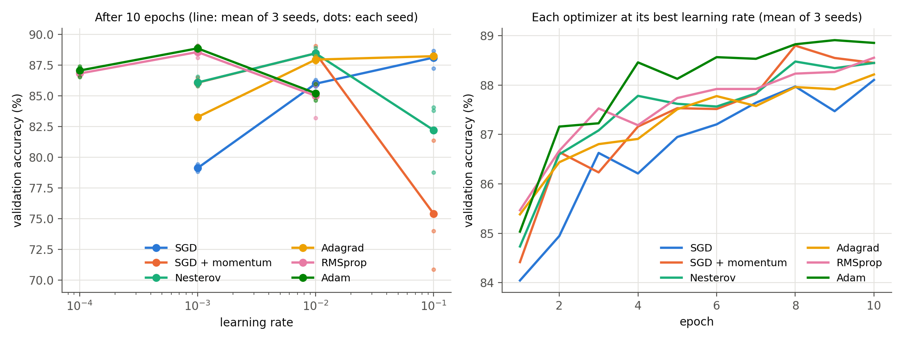
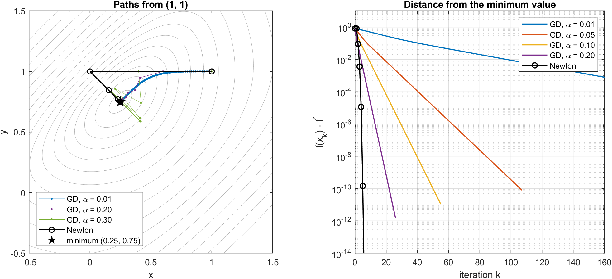
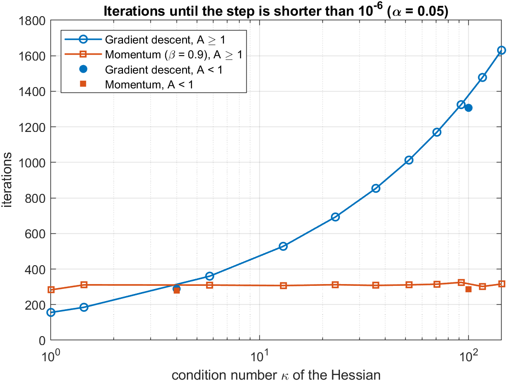
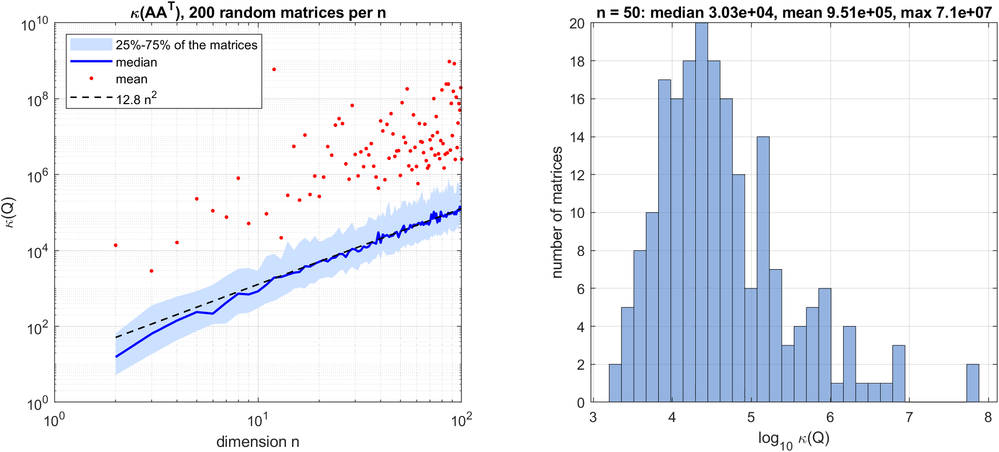
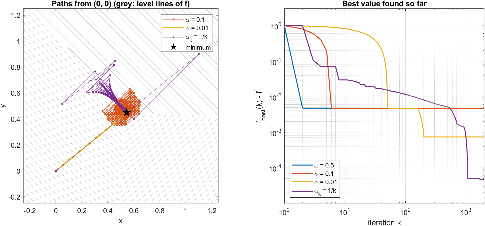
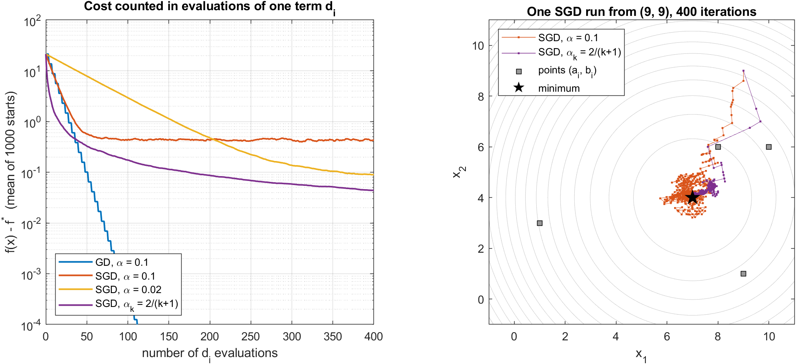
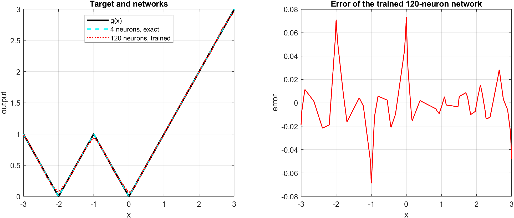
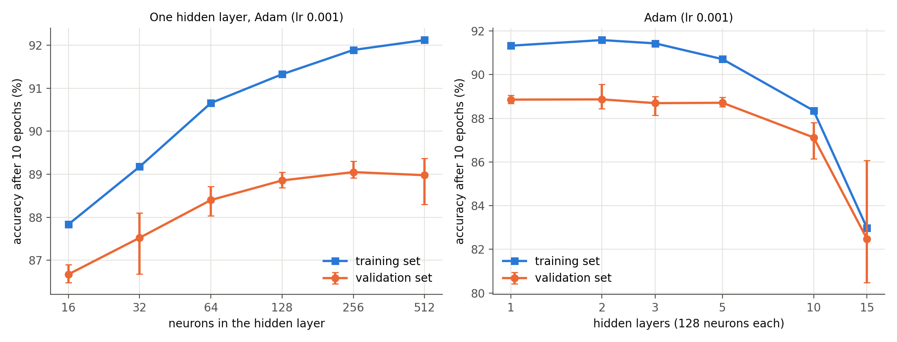

# Gradient methods and neural networks (MATLAB and Python)

This project has two parts. The first part studies how optimization algorithms find the lowest point of a function: gradient descent, Newton's method, momentum, the subgradient method and stochastic gradient descent. The second part builds small neural networks: one by hand, so that it matches a given function exactly, and one image classifier, trained many times to see how the optimizer and the network size change the result. Each problem has its own script, and a report in Greek explains the method and the results step by step.

It is Assignment 2 of the course *Neuro-fuzzy control and applications* (coursework, 2024-2025). Author: Konstantinos Vaios Chronis.

## Highlights

- **The learning rate matters more than the optimizer.** On Fashion-MNIST, six optimizers (SGD, SGD with momentum, Nesterov, Adagrad, RMSprop and Adam) all reach 88.1-88.9% validation accuracy at their best learning rate, but a bad learning rate costs up to 13 points. The best model, picked on validation and tested once, scores 88.10% on the test set.
- **Momentum acts like a 10 times larger step, and the experiments show it.** With β = 0.9, theory says that momentum makes the step about 1/(1 - β) = 10 times larger. Momentum at learning rate 0.001 gives the same accuracy as plain SGD at 0.01 (86.06% against 85.98%), and momentum at 0.01 nearly the same as plain SGD at 0.1 (88.45% against 88.11%).
- **Gradient descent slows down in narrow valleys, momentum does not.** As the condition number grows from 1 to 144, gradient descent needs from 156 to 1,631 iterations, roughly in proportion to its square root. Momentum needs between 280 and 325 iterations at every value.



All numbers come from the code in this repository, run with fixed random seeds, and the theoretical predictions are checked against measurements.

## The assignment

The assignment has two parts. This section says what each problem asks, summarized in English. The original statement is in Greek and is not included here.

### Part 1: Optimization algorithms

Computational questions in numerical optimization, that is, how algorithms that search for the lowest point of a function behave in practice.

1. **Gradient descent and Newton's method.** Take f(x₁, x₂) = x₁² + (x₂ - 1)² + (x₁ - x₂)⁴. Examine how gradient descent converges for different step sizes, and compare it with Newton's method.
2. **Condition number and momentum.** Take f(x₁, x₂) = A x₁² + x₂² / A, with A > 0. Examine how fast gradient descent converges for different values of A. Compute the condition number of the Hessian matrix and explain what you observe. Then apply the momentum method.
3. **Condition number of a random matrix.** Let Q = A Aᵀ, where A is a random matrix, so that Q is symmetric and positive semi-definite. Examine the condition number of Q as a function of the size of the matrix, and explain what you observe.
4. **A function with corners.** Take f(x₁, x₂) = max(x₁ + x₂, 0.9x₁ - 1.1x₂ + 1, -0.8x₁ + 1.2x₂ - 1, 2 - 1.1x₁ - 0.9x₂). Apply gradient descent. Does it converge? If not, why not? How does its behaviour change with the step length? Then try the step 1/k at iteration k.
5. **Stochastic gradient descent.** Take f(x₁, x₂) = ¼ Σᵢ [(x₁ - aᵢ)² + (x₂ - bᵢ)²], a sum over four points (aᵢ, bᵢ). Its gradient is the sum of four terms dᵢ = ½ (x₁ - aᵢ, x₂ - bᵢ)ᵀ. Suppose that each iteration can compute only one of these terms. Apply stochastic gradient descent.

### Part 2: Simple neural networks

1. **A network for a given function.** Build a neural network with one hidden layer of ReLU neurons and a linear output that represents a given function. The assignment shows the function as a plot. Read from the plot, it is made of four straight pieces: g(x) = -x - 2 for x < -2, x + 2 for -2 ≤ x < -1, -x for -1 ≤ x < 0 and x for x ≥ 0.
2. **Classifying clothes.** Work through an image-classification example, either the TensorFlow tutorial *Basic classification* or a PyTorch tutorial on Kaggle. Both classify the Fashion-MNIST images of clothes. Examine how the results depend on the optimization method, the number of neurons and the number of hidden layers.

### Some terms in plain words

- **Gradient descent** looks for the lowest point of a function by taking repeated steps downhill. The **step size**, also called the **learning rate**, sets how far each step goes. **Newton's method** also uses the curvature of the function (the **Hessian**, the matrix of second derivatives) to aim each step.
- The **condition number** measures how stretched a valley is: the ratio of its steepest curvature to its flattest. A large condition number means a long, narrow valley.
- The **momentum** method adds part of the previous step to each new step, like a ball that keeps rolling.
- **Stochastic gradient descent** (SGD) uses only one randomly chosen term of the gradient at each step. Its steps are cheaper, but noisy.
- A **ReLU** neuron outputs ReLU(z) = max(z, 0), where z is a weighted sum of its inputs plus a constant.
- **Fashion-MNIST** has 70,000 small grey images (28 × 28 pixels) of clothes in 10 classes, such as T-shirt, trouser, sneaker and bag.

## What I did

All numbers and plots below come from running the code in this repository (MATLAB R2024b for Part 1 and Problem 2.1, Python with PyTorch for Problem 2.2). The printed output of every script is saved in `outputs/`. The numbers are the same as in the report.

| Problem | Script |
|---|---|
| 1.1 Gradient descent and Newton | `matlab/p1_1_gradient_descent_newton.m` |
| 1.2 Condition number and momentum | `matlab/p1_2_condition_number_momentum.m` |
| 1.3 Random matrices | `matlab/p1_3_random_condition_number.m` |
| 1.4 Subgradient method | `matlab/p1_4_subgradient_piecewise_linear.m` |
| 1.5 Stochastic gradient descent | `matlab/p1_5_stochastic_gradient.m` |
| 2.1 ReLU network | `matlab/p2_1_relu_network.m` |
| 2.2 Fashion-MNIST | `python/fashion_mnist_study.py` |

### 1.1 Gradient descent and Newton's method

I ran gradient descent from (1, 1) with six step sizes, from α = 0.01 to 0.4, and Newton's method from the same point. A run stops when a step is shorter than 10⁻⁶, or after 5,000 iterations. MATLAB computes the gradient and the Hessian symbolically.

The minimum is at (0.25, 0.75), where f = 0.1875. The results of gradient descent:

| Step α | 0.01 | 0.05 | 0.1 | 0.2 | 0.3 | 0.4 |
|---|---|---|---|---|---|---|
| Result | 475 iterations | 107 | 55 | 26 | gets stuck jumping between two points | blows up after 6 iterations |

Newton's method needs 7 iterations. The reason for the limit on α is the curvature at the minimum: the Hessian there has eigenvalues 2 and 8, so gradient descent can only settle if α < 2/8 = 0.25. Up to α = 0.2, a larger step is faster. At α = 0.2 the distance to the minimum shrinks by a factor of 0.6 per iteration, the best a fixed step can do here. At α = 0.3 the method ends up jumping between (0.171, 0.829) and (0.410, 0.590) forever.



### 1.2 Condition number and momentum

The Hessian of f is diag(2A, 2/A), so its condition number is κ = max(A², 1/A²). When A is far from 1, the valley is long and narrow. I tried 13 values of A, from 0.1 to 12. Both methods start from (50, -100) with step α = 0.05. The momentum method uses β = 0.9: x(k+1) = x(k) - α ∇f(x(k)) + β (x(k) - x(k-1)). A run stops when a step is shorter than 10⁻⁶.

| A | 0.1 | 1 | 2.4 | 6 | 12 |
|---|---|---|---|---|---|
| Condition number κ | 100 | 1 | 5.76 | 36 | 144 |
| Gradient descent, iterations | 1307 | 156 | 360 | 854 | 1631 |
| Momentum, iterations | 286 | 283 | 310 | 308 | 316 |

The report has all 13 values of A. For gradient descent, the number of iterations grows roughly in proportion to √κ. The flattest direction of the valley has curvature 2/√κ, and with a fixed step each iteration shrinks the error in that direction only by a factor 1 - 0.1/√κ. The momentum method needs about 280-325 iterations whatever κ is. With β = 0.9, its error shrinks by a factor √β = 0.949 per iteration in both directions, as long as α times each curvature lies between (1 - √β)² and (1 + √β)². That holds for every A tested, so κ does not matter. Momentum is slower than gradient descent only when the valley is nearly round (κ below about 4).



### 1.3 Condition number of a random matrix

For each size n from 2 to 100, I drew 200 random n × n matrices A with independent, standard normal entries, formed Q = A Aᵀ and computed its condition number.

The condition number of Q is the square of that of A. It grows like n²: for n ≥ 50, the median over the 200 matrices is on average 12.8 n² (30,270 for n = 50 and 115,800 for n = 100). The average is a poor summary. A few nearly singular matrices push it far above the median (2.1 × 10⁸ for n = 10, with a median of 840), and in theory its expected value is infinite. For the matrix A itself, log κ(A) - log n averages 1.50 for n ≥ 50, close to the value of about 1.537 predicted by Edelman (1988).



### 1.4 A function with corners

The graph of f has flat faces and sharp edges, and at the edges f has no gradient. So at each point I step along the gradient of whichever of the four linear functions is largest there. This is the subgradient method, the version of gradient descent for such functions. I ran it from (0, 0) for 2,000 iterations, with the fixed step sizes 0.5, 0.1 and 0.01 and with the step 1/k. To measure the error, I also found the true minimum directly, by solving a small linear system.

The minimum is the corner where the first, second and fourth functions meet: x* = (0.5450, 0.4502), f* = 0.9953. With the positive weights 0.479, 0.047 and 0.474, the weighted sum of the three gradients there is zero, and this proves that the corner is the minimum. After 2,000 iterations from (0, 0):

| Step | 0.5 | 0.1 | 0.01 | 1/k |
|---|---|---|---|---|
| Best f - f* | 4.7 × 10⁻³ | 4.7 × 10⁻³ | 7.4 × 10⁻⁴ | 4.7 × 10⁻⁵ |
| Last 200 points stay within | 0.95 of x* | 0.19 | 0.019 | 0.001 |

With a fixed step, the method never settles. The gradient of each face has length about 1.4, so every step has length about 1.4 α and the points keep jumping around x* at a distance proportional to α. A step that shrinks over time, such as 1/k, gets ever closer. For the same reason, the stopping rule "stop when a step is shorter than 10⁻³" does not work: it never fires for a fixed step, and for 1/k it fires after about 1,415 iterations, whatever the point.



### 1.5 Stochastic gradient descent

The assignment leaves the four points open, so I drew them at random with a fixed seed: (8, 6), (9, 1), (1, 3) and (10, 6). I compared gradient descent, which computes all four terms per iteration, with SGD, which computes one random term per iteration. SGD uses the fixed steps 0.1 and 0.02 and the shrinking step 2/(k+1). For a fair comparison, the work is counted in evaluations of one term dᵢ, with a budget of 400. The results are averaged over 1,000 random starting points.

The minimum is the mean of the four points, (7, 4), where f = 17. The values are f - f* averaged over the 1,000 starting points:

| Method | 40 evaluations | 100 | 200 | 400 | Below 0.05 after |
|---|---|---|---|---|---|
| Gradient descent, α = 0.1 | 0.25 | 3.0 × 10⁻⁴ | 4.3 × 10⁻⁹ | 1.5 × 10⁻¹⁶ | 56 evaluations |
| SGD, α = 0.1 | 0.76 | 0.44 | 0.43 | 0.42 | never |
| SGD, α = 0.02 | 9.57 | 2.93 | 0.47 | 0.089 | never |
| SGD, α = 2/(k+1) | 0.41 | 0.17 | 0.087 | 0.044 | 357 evaluations |

With a fixed step, SGD stops improving at a noise level that theory puts at α s / (4 - α), where s = 17 is the mean squared distance of the points from their mean. Long runs confirm it: 0.44 measured against 0.436 predicted for α = 0.1, and 0.088 against 0.085 for α = 0.02. A smaller step lowers the noise level but takes longer to get there. With α = 2/(k+1), each SGD point is the average of the starting point and the points sampled so far, so the error keeps falling, like 1/k. Here gradient descent wins easily, because the full gradient has only four terms and the function is a round bowl. SGD pays off when the gradient is a sum of very many terms, as in neural network training.



### 2.1 A network for a given function

I built the network by hand, checked it in MATLAB and proved that fewer neurons cannot work. For comparison, I also trained a large network on the same function.

Four hidden neurons are enough:

g(x) = ReLU(x) + ReLU(-x) - 2 ReLU(-x - 1) + 2 ReLU(-x - 2).

The network with these weights matches g exactly (the largest error on [-3, 3] is 0). Three neurons are not enough. With three neurons, each one must make one of the three corners of g, at -2, -1 and 0, where the slope of g changes by +2, -2 and +2. At the far right, only the neurons that face right are active, so the slope there (+1) would have to be the sum of some of these changes. Every such sum is even, so this is impossible.

A network with 120 hidden neurons trained with plain gradient descent (MATLAB `traingd`, 1,200 epochs) gets close but not exact. Its largest error is 0.074 and its average error 0.012. The largest errors are at the corners, which the trained network rounds off. Away from the corners the average error is 0.008.



### 2.2 Classifying clothes

I started from the model of the TensorFlow tutorial and wrote it in PyTorch. Each 28 × 28 image becomes a list of 784 numbers. A hidden layer of 128 ReLU neurons follows, then an output of 10 numbers, one per class. The model trains for 10 epochs (10 passes over the training images) in batches of 32 images. I then trained it with 6 optimizers at 3 learning rates each, with 16 to 512 neurons, and with 1 to 15 hidden layers.

**How it was tested.** The 60,000 training images are split once into 54,000 for training and 6,000 for validation. Every setting is trained 3 times, with different random seeds, and the settings are compared on validation accuracy. The 10,000 test images are used only once, at the end, for the setting chosen on validation, so the final test accuracy is a fair estimate for new images.

**Optimizer and learning rate.** Validation accuracy, as the mean of the 3 seeds, for three learning rates per optimizer (the best one in bold):

| Optimizer | Small learning rate | Middle | Large |
|---|---|---|---|
| SGD | 0.001: 79.12% | 0.01: 85.98% | **0.1: 88.11%** |
| SGD + momentum | 0.001: 86.06% | **0.01: 88.45%** | 0.1: 75.41% |
| Nesterov | 0.001: 86.08% | **0.01: 88.45%** | 0.1: 82.21% |
| Adagrad | 0.001: 83.27% | 0.01: 87.94% | **0.1: 88.22%** |
| RMSprop | 0.0001: 86.81% | **0.001: 88.56%** | 0.01: 84.99% |
| Adam | 0.0001: 87.05% | **0.001: 88.86%** | 0.01: 85.21% |

- The learning rate matters far more than the optimizer. At its best learning rate, every optimizer reaches 88.1-88.9%, and differences of that size are close to the spread between seeds. A bad learning rate costs up to 13 points.
- Momentum with β = 0.9 makes the steps about 1/(1 - β) = 10 times larger. So momentum at learning rate 0.001 matches plain SGD at 0.01 (86.06% against 85.98%), and momentum at 0.1 is too large: training becomes unstable (75.41% on average, from 70.88% to 81.35% across seeds).
- Adagrad divides each step by the sum of all past squared gradients, so its steps keep shrinking and it needs the largest learning rate. Adam is the best (88.86%, with a standard deviation of 0.18 across seeds), and it leads in every epoch from the 4th on.


**Network size.** Accuracy in %, with Adam at learning rate 0.001:

| Neurons (one hidden layer) | 16 | 32 | 64 | 128 | 256 | 512 |
|---|---|---|---|---|---|---|
| Training accuracy | 87.83 | 89.18 | 90.66 | 91.33 | 91.89 | 92.12 |
| Validation accuracy | 86.67 | 87.52 | 88.40 | 88.86 | 89.05 | 88.98 |

| Hidden layers (128 neurons each) | 1 | 2 | 3 | 5 | 10 | 15 |
|---|---|---|---|---|---|---|
| Training accuracy | 91.33 | 91.58 | 91.43 | 90.71 | 88.35 | 82.98 |
| Validation accuracy | 88.86 | 88.87 | 88.69 | 88.71 | 87.12 | 82.48 |

- More neurons keep raising the training accuracy, but the validation accuracy stops improving after about 128-256 neurons. The gap between the two grows from 1.2 to 3.1 points: the extra neurons go into memorizing the training images (overfitting), not into handling new ones.
- One to five hidden layers give the same validation accuracy. With 10 and 15 layers, the training accuracy falls too, so the problem is not overfitting: a deep network of this simple kind is harder to train, and 10 epochs are not enough. Size is not the reason. The 15-layer network has fewer parameters (332,938) than the single layer of 512 neurons (407,050), which trains without trouble.



**Final model.** The best setting on validation is one hidden layer of 256 neurons with Adam at learning rate 0.001 (89.05%). On the test set it scores 88.10% (88.09%, 88.11% and 88.09% for the 3 seeds). That is about 1 point lower than on validation, partly because this setting was picked as the best of 28 on the same validation images. For one of the three trained networks, three quarters of the mistakes are on coats (69.9% correct), shirts (76.0%), pullovers (80.8%) and T-shirts (83.4%). These look alike in small grey images. Bags, shoes and trousers are recognized more than 94% of the time.

## Run it

**Part 1 and Problem 2.1 (MATLAB).** Open MATLAB in the `matlab/` folder and type the name of a script, for example:

```matlab
p1_2_condition_number_momentum
```

Each script runs on its own, prints its results and saves its figure in `figures/`. To run them all and save the printed output in `outputs/`, type `run_all`. That takes about two minutes. The scripts that use random numbers fix the seed, so they print the numbers shown above. Checked with MATLAB R2024b. Problem 1.1 needs the Symbolic Math Toolbox, and Problem 2.1 needs the Deep Learning Toolbox.

**Problem 2.2 (Python).** Install Python 3 with PyTorch, torchvision, NumPy and Matplotlib, then run:

```bash
python python/fashion_mnist_study.py
```

The first run downloads Fashion-MNIST (about 30 MB) into `python/data/`. The script trains every setting with 3 seeds, writes the results to `outputs/` and draws the two figures in `figures/`. On a laptop CPU the full study takes about an hour and a half. To redraw the figures from the saved results without training, add `--figures-only`. Checked with Python 3, PyTorch 2.5 and torchvision 0.20.

## Repository contents

```
matlab/    the six MATLAB scripts and run_all.m
python/    the Fashion-MNIST study
outputs/   the printed results of every script, and the Fashion-MNIST results (CSV and JSON)
figures/   the plots shown in this README, made by running the code
report/    the full report (Greek): method, code excerpts, results and discussion
```

## Sources and credits

- **Assignment.** The problems are from Assignment 2 of the course *Neuro-fuzzy control and applications* (2024-2025). The problem statement belongs to the course and is not included here. This README only summarizes it.
- **Gradient descent code.** The gradient descent loop in Problem 1.1 follows the structure of the video tutorial *2022 How to do Gradient Descent Optimization Algorithm in MATLAB | MATLAB Tutorial*.
- **Fashion-MNIST.** H. Xiao, K. Rasul and R. Vollgraf, *Fashion-MNIST: a Novel Image Dataset for Benchmarking Machine Learning Algorithms*, arXiv:1708.07747, 2017. The dataset is by Zalando Research and is released under the MIT License. It is downloaded by the script and is not included in this repository.
- **Base classifier.** The assignment points to two starting examples: the TensorFlow tutorial [Basic classification: Classify images of clothing](https://www.tensorflow.org/tutorials/keras/classification) and a PyTorch tutorial on Kaggle. The base model of Problem 2.2 (one hidden layer of 128 neurons, 10 epochs, batch size 32) follows the TensorFlow tutorial and is written here in PyTorch. No code from the Kaggle tutorial is used.
- **Theory used in the report.** A. Edelman, *Eigenvalues and condition numbers of random matrices*, SIAM Journal on Matrix Analysis and Applications 9(4), 1988 (Problem 1.3). B. T. Polyak, *Some methods of speeding up the convergence of iteration methods*, USSR Computational Mathematics and Mathematical Physics 4(5), 1964 (the momentum method, Problem 1.2).
- **Own work.** The MATLAB and Python code, the experiments and the report are the author's own work for this assignment.
- **Tools.** [MATLAB](https://www.mathworks.com/products/matlab.html) with the Symbolic Math and Deep Learning Toolboxes, [Python](https://www.python.org/), [PyTorch](https://pytorch.org/) and torchvision, [NumPy](https://numpy.org/) and [Matplotlib](https://matplotlib.org/).
- The logo on the report's title page belongs to the university where the course was taught.

## License

None. This work is shared for viewing only, and all rights are reserved by the author.
